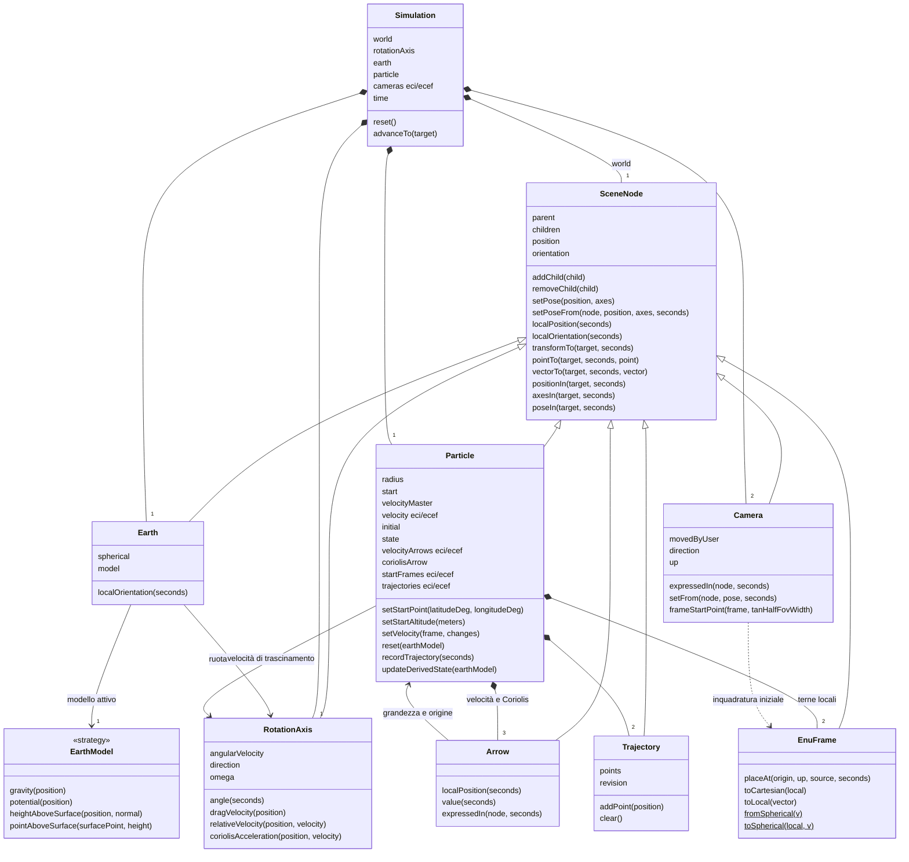
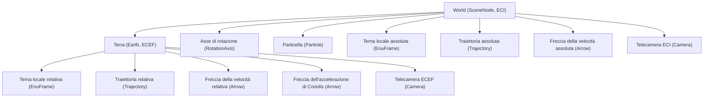

# Modello

Schema delle classi del modello (`src/model/`) e della gerarchia della
scena. Va aggiornato insieme al codice: il test
`test/modelDiagram.test.js` verifica che le classi del diagramma
corrispondano a quelle esportate da `src/model/` e che le sottoclassi di
`SceneNode` siano indicate come tali.

## Classi

Convenzioni del diagramma:
- `<|--` ereditarietà; `*--` composizione (crea e possiede);
  `-->` riferimento (usa senza possedere);
- `<<strategy>>`: oggetto che non è una classe (modelli di Terra);
- i campi `eci`/`ecef` indicano una coppia di oggetti, uno per sistema
  (vedi `bySystem`): assoluto (figlio di World) e relativo (figlio della
  Terra).

## Gerarchia della scena

Relazioni padre-figlio costruite da `Simulation.#buildScene()` con
`SceneNode.addChild`. Ogni nodo ha la posa espressa nel sistema del
padre: World è il sistema ECI, la Terra il sistema ECEF.

